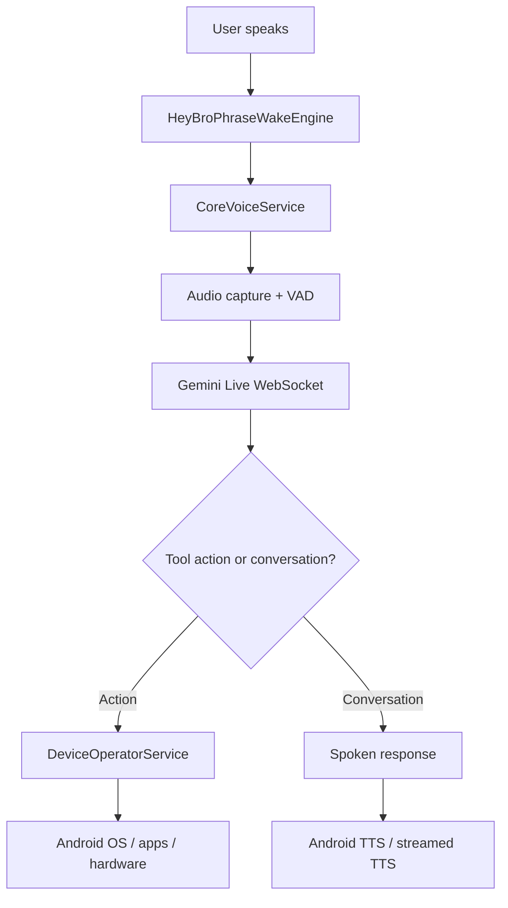

# Hey Bro

Hey Bro is an Android-first voice assistant with a Flutter dashboard and an Android-native, edge-first voice pipeline. Live voice connects directly from Android to Gemini over WebSockets; no Python middleware backend is included in this repository.

The project is designed to handle the full lifecycle of an assistant experience:

- wake-word detection on the device
- microphone capture and local fallback processing
- transcription and decision-making through LLMs or local rules
- device automation through Android Accessibility APIs, notifications, hardware controls, and app launches
- streamed Gemini audio responses and on-device TTS fallback

This repository includes the Flutter UI, Android audio and automation services, and direct Gemini Live integration.

---

## Overview

At a high level, the system works like this:

1. The user says a wake phrase such as "Hey Bro".
2. Android wake detection picks it up and starts listening.
3. Audio is captured and sent to the assistant pipeline.
4. Gemini Live transcribes the audio and decides whether the request is:
   - a conversational question
   - a system command
   - an action to execute on the phone
5. Deterministic local commands execute through `LocalCommandProcessor`; other actions execute through `DeviceOperatorService`.
6. The assistant sends a spoken response back to the user.

This makes Hey Bro a hybrid system: local wake detection and deterministic device control, plus direct cloud intelligence for advanced reasoning.

---

## Project structure

```text
hey_bro/
├── README.md
├── project_details.md
├── analysis_options.yaml
├── pubspec.yaml
├── pubspec.lock
├── test/
├── lib/
│   └── main.dart
├── android/
│   ├── app/
│   │   └── src/main/
│   │       ├── AndroidManifest.xml
│   │       ├── kotlin/com/example/hey_bro/
│   │       │   ├── MainActivity.kt
│   │       │   ├── CoreVoiceService.kt
│   │       │   ├── DeviceOperatorService.kt
│   │       │   ├── AudioStreamer.kt
│   │       │   ├── HeyBroPhraseWakeEngine.kt
│   │       │   ├── WakeWordManager.kt
│   │       │   ├── LocalSttEngine.kt
│   │       │   ├── LocalTtsEngine.kt
│   │       │   ├── GeminiIntentBridge.kt
│   │       │   ├── LocalCommandProcessor.kt
│   │       │   ├── HeyBroNotificationListenerService.kt
│   │       │   ├── OverlayManager.kt
│   │       │   ├── VoiceLearningStore.kt
│   │       │   ├── SileroVad.kt
│   │       │   ├── BootReceiver.kt
│   │       │   ├── OpenWakeWordEngine.kt
│   │       │   ├── PicovoiceEngine.kt
│   │       │   ├── ViolaWakeEngine.kt
│   │       │   ├── SimpleAudioWakeTrigger.kt
│   │       │   ├── CoreRecognitionService.kt
│   │       │   ├── CoreVoiceInteractionService.kt
│   │       │   ├── CoreVoiceInteractionSession.kt
│   │       │   ├── CoreVoiceInteractionSessionService.kt
│   │       │   ├── IWakeWordEngine.kt
│   │       │   └── NativeSpeechEngine.kt
│   │       └── res/xml/accessibility_service_config.xml
│   └── build.gradle.kts
├── ios/
├── linux/
├── macos/
├── windows/
├── web/
├── build/
└── .gitignore
```

---

## Architecture

The project is split into three main layers:

### 1. Flutter app layer
This is the visible control plane and diagnostics dashboard. It is built in `lib/main.dart`.

Responsibilities:
- UI for the assistant dashboard
- permission checks and request flows
- native Android service controls
- event handling from the Android layer
- Gemini connection settings and live state updates

### 2. Android native layer
The app logic is implemented in Kotlin under `android/app/src/main/kotlin/com/example/hey_bro/`.

Responsibilities:
- wake detection
- microphone capture and audio filtering
- local STT fallback and TTS
- accessibility-driven action execution
- notifications and phone/system access
- overlay UI and foreground service lifecycle

### 3. Direct cloud connection
`AudioStreamer.kt` connects directly to Gemini Live. There is no `backend/` directory or server process in this checkout; offline command handling and STT/TTS fallbacks remain on-device.

---

## End-to-end request flow



### Detailed flow

1. User speaks a command or question.
2. The wake engine is listening in the background for the trigger phrase.
3. Once the wake phrase is detected, the assistant begins the active listening cycle.
4. `CoreVoiceService` captures audio and attempts local or remote processing.
5. Audio is streamed directly from Android to Gemini Live; Silero VAD retains onset audio and detects turn boundaries.
6. Local deterministic commands run alongside live transcription; Gemini tool calls handle other requests.
7. The assistant chooses the next action:
   - open app
   - send WhatsApp message
   - make call
   - set alarm or timer
   - reply to notification
   - control hardware
   - respond conversationally
8. If needed, the action is dispatched to Android via the native action framework.
9. A spoken response is generated and sent back to the device.

---

## Flutter app (`lib/main.dart`)

The main Flutter file is the dashboard/control center for the assistant.

### Core pieces in `lib/main.dart`

- `main()`
  - launches the app
- `HeyBroApp`
  - root `MaterialApp`
- `AssistantState`
  - state enum used for UI status (`idle`, `listening`, `processing`, `playing`, `disconnected`)
- `DashboardScreen`
  - main dashboard UI
- `_onNativeEvent`
  - receives native Android events via `EventChannel`
- `_checkPermissions()`
  - checks current device permission state
- `_toggleService()`
  - starts or stops the assistant service
- `_loadBackendConfig()`
  - reads configured Gemini WebSocket URL
- `MethodChannel('com.example.hey_bro/assistant')`
  - bridge between Flutter and native Android
- `EventChannel('com.example.hey_bro/events')`
  - stream status updates from Android to Flutter

### Dashboard responsibilities

The dashboard displays:
- service runtime state
- active engine name
- live connection status
- microphone and accessibility permission status
- local assistant state
- transcript history
- quick debug controls

It is effectively the operations console for the whole assistant.

---

## Android native app layer

The main Android code lives under:

`android/app/src/main/kotlin/com/example/hey_bro/`

### `MainActivity.kt`
This is the bridge between Flutter and Android system services.

Responsibilities:
- start and stop the assistant service
- request runtime permissions for mic, notifications, camera, overlay, etc.
- request system settings screens for accessibility and notification access
- expose native methods to Flutter via `MethodChannel`
- manage WebSocket URL storage and Gemini-related features

Relevant methods include:
- `configureFlutterEngine`
- `startAssistantService()`
- `stopAssistantService()`
- `checkPermissions()`
- `requestCommunicationPermissions()`
- `requestNotificationAccess()`
- `requestAccessibilityPermission()`
- `requestOverlayPermission()`
- `getBackendWs`
- `setBackendWs`

### `CoreVoiceService.kt`
This is the main service orchestrator.

It coordinates:
- wake engine lifecycle
- local speech recognition
- audio focus
- service states
- direct Gemini Live communication
- fallback behavior when Gemini is unavailable
- overlay state and assistant UI events

Important state values:
- `IDLE`
- `LISTENING`
- `PROCESSING`
- `SPEAKING`

It acts as the central runtime brain for the assistant.

### `HeyBroPhraseWakeEngine.kt`
This implements the wake phrase detection layer.

Responsibilities:
- listens for a wake phrase such as "Hey Bro"
- normalizes spoken text candidates
- checks for a phrase match
- calls back into the assistant when the wake phrase triggers
- suppresses system sound noise and retries when recognition fails

### `AudioStreamer.kt`
This is the real-time streaming class used for audio playback and socket-based interaction.

Features:
- creates WebSocket connections to Gemini Live
- sends PCM audio chunks to the remote endpoint
- receives model-generated audio responses
- writes received audio to Android `AudioTrack`
- handles reconnect logic and retry timing
- manages realtime streaming payloads

Important aspects:
- uses `AudioTrack` with 24kHz output for voice playback
- sends audio chunks as base64-encoded PCM `realtimeInput`
- supports reconnect and failover when a stream drops

### `DeviceOperatorService.kt`
This is the execution engine for all physical device actions.

It runs as an Android `AccessibilityService` and can do things like:
- tap UI elements
- type into text fields
- open apps
- make calls
- send WhatsApp messages
- set alarms and timers
- search the web
- play media
- control hardware like flashlight, volume, Wi-Fi, Bluetooth, airplane mode, brightness
- open system screens
- read or reply to notifications
- take screenshots
- navigate home, back, recents, notifications, quick settings

Main method:
- `executeCommand(payload: String)`

This function handles both standard actions and compound multi-action payloads.

### `HeyBroNotificationListenerService.kt`
This monitors notifications and can:
- read the latest incoming notification text
- summarize messages for the assistant
- send direct replies to notification sources

### `LocalSttEngine.kt`
Performs on-device speech recognition as a fallback path when live voice is unavailable.

### `LocalTtsEngine.kt`
Wraps Android text-to-speech for local spoken output.

### `LocalCommandProcessor.kt`
Processes locally detected commands with a lightweight rule-based or fuzzy matcher before falling back further.

### `GeminiIntentBridge.kt`
Handles direct Gemini-based intent bridging when a native LLM decision path is needed.

### `OverlayManager.kt`
Displays the visible floating assistant effect and overlays state.

### `VoiceLearningStore.kt`
Stores transcript and action behavior for learning and refinement.

### `WakeWordManager.kt`
Manages wake engines and switching strategies.

### `SileroVad.kt`
Runs voice activity detection to help determine whether a user is speaking and to improve voice detection quality.

### Other native support files
- `BootReceiver.kt` – autostart integration
- `OpenWakeWordEngine.kt` – alternative wake engine implementation
- `PicovoiceEngine.kt` – third-party wake engine integration
- `ViolaWakeEngine.kt` – another engine option
- `SimpleAudioWakeTrigger.kt` – lightweight wake trigger implementation
- `CoreRecognitionService.kt` and related voice-interaction classes – deeper Android voice integration files
- `IWakeWordEngine.kt` – wake engine interface

---

## Live voice and local resilience

The Android `AudioStreamer` sends 16 kHz PCM directly to Gemini Live and plays returned 24 kHz PCM as it arrives. Response text is streamed to the Flutter overlay as it is generated, then saved to conversation history once the audio turn completes. Native events are sequenced on the main thread and include a session ID so stale updates cannot roll the dashboard backward. Local VAD, a rolling onset buffer, deterministic command handling, and `LocalSttEngine`/`LocalTtsEngine` fallback keep device control usable without an intermediary server. A custom WebSocket URL remains configurable for deployments that provide a compatible service, but that service is not part of this repository.

---

## Supported commands and device actions

The Android action layer supports a broad set of phone actions.

### App and navigation actions
- open app
- open camera
- global home/back/actions
- tap UI element
- type into field
- search web
- play media
- screenshot
- recents / notifications / quick settings

### Communication actions
- send WhatsApp message
- make call
- reply to notification

### System and device actions
- set alarm
- set timer
- control hardware (flashlight, wifi, bluetooth, volume, airplane mode, brightness)
- lock screen
- open settings

### Example action schema

```json
{
  "type": "ACTION",
  "action": "openApp",
  "params": {
    "appName": "WhatsApp"
  },
  "reply": "Opening WhatsApp."
}
```

And compound actions are also supported:

```json
{
  "type": "MULTI_ACTION",
  "actions": [
    { "action": "openApp", "params": { "appName": "Spotify" } },
    { "action": "playMedia", "params": { "query": "lofi beats", "app": "Spotify" } }
  ]
}
```

---

## Gemini configuration

Set `GEMINI_API_KEY` in `.env` or configure it in the dashboard. Native code uses the configured Gemini Live model and preserves the existing `com.example.hey_bro/assistant` and `com.example.hey_bro/events` channel contracts.

---

## Local development setup

Install Flutter and the Android SDK, then run:

```bash
flutter pub get
flutter analyze
flutter test
flutter run
```

---

## Typical usage

Examples of commands the assistant is designed to handle:

- "Open WhatsApp"
- "Play music on YouTube"
- "Turn on flashlight"
- "Set an alarm for 7:30 AM"
- "Send a WhatsApp message to John: I'll be there in 10 minutes"
- "Make a phone call to 9876543210"
- "Search for weather updates"
- "What is the capital of France?"
- "Read my latest notification"

---

## Developer notes

This project is intentionally built with a hybrid architecture:

- local voice wake detection and device responsiveness
- cloud fallback for better transcriptions and reasoning
- Android-native action execution
- a layered fallback strategy so the assistant remains useful if one provider fails

This is not a simple one-file app. It is a complete assistant stack built for real mobile automation.

---

## Files to understand first

If a new developer is joining the project, the best files to review first are:

1. `lib/main.dart` – Flutter control app
2. `android/app/src/main/kotlin/com/example/hey_bro/CoreVoiceService.kt` – main service orchestration
3. `android/app/src/main/kotlin/com/example/hey_bro/DeviceOperatorService.kt` – device action engine
4. `android/app/src/main/kotlin/com/example/hey_bro/AudioStreamer.kt` – realtime audio/WebSocket layer
5. `project_details.md` – deeper architectural reference

---

## Summary

Hey Bro is an edge-first voice assistant that spans:

- Flutter app UI
- Android native automation layer
- direct Gemini Live transcription and tool selection
- real device actions through Accessibility APIs
- TTS and response playback

This repository provides a clear roadmap for building a real smartphone assistant that can understand natural language, act on the user's device, and speak back naturally.

For a deeper architectural specification, see `project_details.md`.