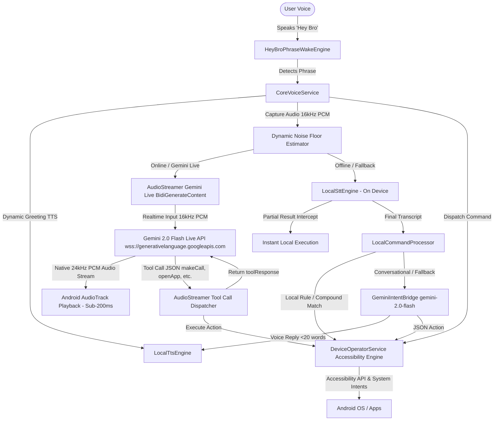

# Hey Bro AI - End-to-End Architectural Specification & Reference

This document is the master technical specification for the **"Hey Bro"** AI Voice Assistant ecosystem. It details every subsystem, file, data flow, API contract, and native Android capability across the Flutter client, Android native services, and serverless Gemini Multimodal Live pipeline.

---

## 📑 Table of Contents
1. [Architecture & System Flow](#1-architecture--system-flow)
2. [Complete Directory & File Structure](#2-complete-directory--file-structure)
3. [Audio Pipeline & Latency Optimization](#3-audio-pipeline--latency-optimization)
4. [Android Native Subsystems & Permissions](#4-android-native-subsystems--permissions)
5. [Gemini Multimodal Live Cloud Protocol](#5-gemini-multimodal-live-cloud-protocol)
6. [Flutter UI & Bridge Contracts](#6-flutter-ui--bridge-contracts)
7. [Preferences & Configuration](#7-preferences--configuration)
8. [Comprehensive Action & Tool Catalog](#8-comprehensive-action--tool-catalog)

---

## 1. Architecture & System Flow

"Hey Bro" operates on a **100% Serverless Cloud Live Voice Architecture (Gemini Multimodal Live API)** with offline local fallback:



### End-to-End Interaction Timeline
1. **Continuous Silent Wake Monitoring**: `HeyBroPhraseWakeEngine` runs on-device without network overhead. System feedback tones and start beeps are suppressed via `AudioManager` muting and `RecognizerIntent` flags.
2. **Wake Activation & Greeting**: When "Hey Bro" is detected, `CoreVoiceService` initiates a quick spoken acknowledgement (*"Hi Sandip, what can I do for you?"*), shows the glowing overlay, and transitions to `ServiceState.LISTENING`.
3. **Direct Gemini Live Ingestion**:
   - `AudioStreamer` establishes a bidirectional WebSocket connection to `wss://generativelanguage.googleapis.com/ws/google.ai.generativelanguage.v1beta.GenerativeService.BidiGenerateContent?key={GEMINI_API_KEY}`.
   - Initial handshake declares system instructions, voice configuration (`Aoede`), and tool definitions for all 100+ phone actions.
   - Streamed audio is sent as 16kHz PCM `realtimeInput` chunks.
4. **Sub-200ms Neural Audio & Tool Calling**:
   - Gemini Live returns native 24kHz 16-bit PCM Linear Mono audio (`inlineData`) streamed directly to Android `AudioTrack`.
   - When Gemini invokes a tool (e.g. `makeCall`, `replyNotification`, `controlHardware`, `openApp`, `sendWhatsApp`, `readNotifications`), `AudioStreamer` unpacks parameters, executes the command via `DeviceOperatorService`, and sends a `toolResponse` back over WebSocket.
   - Natural voice interruption / barge-in is supported: when the user speaks while the model is responding, `interrupted` flushes the `AudioTrack` immediately.
5. **Offline / Fallback Resilience**:
   - If internet is unavailable or socket disconnects, the system instantly delegates to `LocalSttEngine` + `LocalCommandProcessor` + `GeminiIntentBridge` for local execution without user interruption.

---

## 2. Complete Directory & File Structure

```
hey_bro/
├── lib/                                    # Flutter UI & Client
│   └── main.dart                           # Glowing orb UI, state manager, method/event channel bridge
│
├── android/                                # Native Android Platform Code
│   ├── app/src/main/
│   │   ├── AndroidManifest.xml             # OS permissions, services, accessibility declarations
│   │   ├── res/
│   │   │   ├── xml/accessibility_service_config.xml # Accessibility config & capabilities
│   │   │   └── values/styles.xml
│   │   └── kotlin/com/example/hey_bro/
│   │       ├── MainActivity.kt             # Flutter engine activity & permissions bridge
│   │       ├── CoreVoiceService.kt         # Foreground voice service & master state machine
│   │       ├── DeviceOperatorService.kt    # Accessibility automation engine (100+ actions)
│   │       ├── HeyBroNotificationListenerService.kt # Notification reader & RemoteInput replier
│   │       ├── LocalCommandProcessor.kt    # Offline fuzzy intent parser & compound unroller
│   │       ├── GeminiIntentBridge.kt       # Direct on-device gemini-2.0-flash bridge
│   │       ├── LocalSttEngine.kt           # On-device SpeechRecognizer with error recovery
│   │       ├── LocalTtsEngine.kt           # Android TextToSpeech wrapper
│   │       ├── HeyBroPhraseWakeEngine.kt   # Continuous silent phrase detector
│   │       ├── WakeWordManager.kt          # Wake engine abstraction & switching
│   │       ├── SileroVad.kt                # On-device Silero Voice Activity Detector (ONNX)
│   │       ├── AudioStreamer.kt            # Gemini Live WebSocket client & AudioTrack PCM player
│   │       ├── OverlayManager.kt           # System alert window floating orb overlay
│   │       └── VoiceLearningStore.kt       # Persistent transcript-to-action learning memory
│   ├── build.gradle.kts                    # Root build configuration
│   └── app/build.gradle.kts                # Android app dependencies (coroutines, ONNX, JSON)
│
├── backend/                                # [OPTIONAL / LEGACY] Self-Hosted FastAPI Server
│   ├── main.py                             # Optional local server fallback
│   ├── run.py                              # Local runner
│   ├── requirements.txt                    # Python dependencies
│   └── .env                                # Legacy credentials
│
└── project_details.md                      # Comprehensive architecture specification
```

---

## 3. Audio Pipeline & Latency Optimization

### 3.1 Audio Ingest & Playback Specifications
- **Audio Ingest (Microphone -> Cloud / Local)**: `16,000 Hz` (16kHz), `16-bit Linear PCM Mono` (`AudioFormat.ENCODING_PCM_16BIT`, `AudioFormat.CHANNEL_IN_MONO`), 512 samples per frame (32ms).
- **Audio Output (Gemini Live -> AudioTrack)**: `24,000 Hz` (24kHz), `16-bit Linear PCM Mono` (`AudioTrack` configured with `24000` sample rate).

### 3.2 Dynamic Noise Floor Calibration ([CoreVoiceService.kt](file:///d:/hey_bro/android/app/src/main/kotlin/com/example/hey_bro/CoreVoiceService.kt))
- **Sampling Window**: First 5 frames (~160ms) establish `noiseFloorRms`.
- **Active Speech Threshold**: `(noiseFloorRms * 2.2f).coerceIn(0.005f, 0.025f)`
- **Trailing Silence Threshold**: `(noiseFloorRms * 1.3f).coerceIn(0.003f, 0.015f)`
- **Silero VAD Integration**: Evaluates neural network score `vadScore > 0.35f` to confirm human voice against background noise.

### 3.3 Fast End-of-Speech (EOS) & Natural Interruption
- Captures trailing silence frames. When `speechDetected && silenceFrames >= 8` (~256ms), transitions to `ServiceState.PROCESSING`.
- When user speaks while model audio is playing, `AudioTrack` is immediately flushed and paused (natural barge-in).

---

## 4. Android Native Subsystems & Permissions

### 4.1 Android Manifest Permissions & Declarations
The app declares the following required permissions in `android/app/src/main/AndroidManifest.xml`:

| Permission | Purpose & Scope |
| :--- | :--- |
| `android.permission.RECORD_AUDIO` | High-priority mic capture for wake phrase detection and streaming live voice. |
| `android.permission.READ_PHONE_STATE` | Required by `TelecomManager` to query call-capable SIM handles (`callCapablePhoneAccounts`). |
| `android.permission.CALL_PHONE` | Dispatches direct phone calls via SIM 1 or SIM 2 without dropping to dialer screen. |
| `android.permission.BIND_NOTIFICATION_LISTENER_SERVICE` | Required for `HeyBroNotificationListenerService` to access notifications and extract `RemoteInput` reply actions. |
| `android.permission.SYSTEM_ALERT_WINDOW` | Displays the floating glowing overlay UI (`OverlayManager`) over other apps. |
| `android.permission.BIND_ACCESSIBILITY_SERVICE` | Grants `DeviceOperatorService` access to tap UI, scroll, input text, and navigate system settings. |
| `android.permission.CAMERA` | Controls camera torch/flashlight and photo capture. |
| `android.permission.SEND_SMS` | Dispatches direct SMS messages upon voice command. |
| `android.permission.READ_CONTACTS` | Resolves contact names for calls and WhatsApp messages. |

### 4.2 Native Kotlin Components
- **[`CoreVoiceService.kt`](file:///d:/hey_bro/android/app/src/main/kotlin/com/example/hey_bro/CoreVoiceService.kt)**: Foreground service, audio focus management, state machine (`IDLE`, `LISTENING`, `PROCESSING`, `SPEAKING`), WebSocket live bridge, fallback watchdog.
- **[`DeviceOperatorService.kt`](file:///d:/hey_bro/android/app/src/main/kotlin/com/example/hey_bro/DeviceOperatorService.kt)**: Accessibility automation engine (100+ actions, `clickNode`, `setTextNode`, `makeCall` with SIM slots, `controlHardware`, `MULTI_ACTION` unrolling).
- **[`HeyBroNotificationListenerService.kt`](file:///d:/hey_bro/android/app/src/main/kotlin/com/example/hey_bro/HeyBroNotificationListenerService.kt)**: Synchronized notification caching (`ConcurrentHashMap`), direct background replies via `RemoteInput.addResultsToIntent`, and spoken message summaries.
- **[`LocalCommandProcessor.kt`](file:///d:/hey_bro/android/app/src/main/kotlin/com/example/hey_bro/LocalCommandProcessor.kt)**: Phonetic normalization, homophone correction, compound command parsing (`checkCompoundCommands`), offline rule matches, regex extractors.
- **[`GeminiIntentBridge.kt`](file:///d:/hey_bro/android/app/src/main/kotlin/com/example/hey_bro/GeminiIntentBridge.kt)**: On-device `gemini-2.0-flash` bridge, JSON schema mode, conversational Alexa/Echo Q&A generator (<20 words).
- **[`LocalSttEngine.kt`](file:///d:/hey_bro/android/app/src/main/kotlin/com/example/hey_bro/LocalSttEngine.kt)**: On-device `SpeechRecognizer`, Error 11 recovery, fast timeouts (`600L`/`500L`/`400L`), smart partial result interception.
- **[`HeyBroPhraseWakeEngine.kt`](file:///d:/hey_bro/android/app/src/main/kotlin/com/example/hey_bro/HeyBroPhraseWakeEngine.kt)**: Continuous offline wake recognition, start-beep / chime suppression (`AudioManager.STREAM_SYSTEM` mute and `RecognizerIntent` feedback suppression).

---

## 5. Gemini Multimodal Live Cloud Protocol

The client communicates directly with Google's Gemini Multimodal Live API over secure WebSockets without intermediary proxy servers.

### 5.1 Connection Handshake
- **Endpoint**: `wss://generativelanguage.googleapis.com/ws/google.ai.generativelanguage.v1beta.GenerativeService.BidiGenerateContent?key={GEMINI_API_KEY}`
- **Initial Setup Frame (Client -> Cloud)**:
  Sent immediately upon WebSocket connection open:
  ```json
  {
    "setup": {
      "model": "models/gemini-2.0-flash-exp",
      "generationConfig": {
        "responseModalities": ["AUDIO"],
        "speechConfig": {
          "voiceConfig": {
            "prebuiltVoiceConfig": {
              "voiceName": "Aoede"
            }
          }
        }
      },
      "systemInstruction": {
        "parts": [{
          "text": "You are Hey Bro, an ultra-fast, direct voice assistant. Keep all spoken replies under 15 words. When the user requests an action, invoke the corresponding tool function immediately."
        }]
      },
      "tools": [{
        "functionDeclarations": [
          { "name": "makeCall", "description": "Places a phone call with optional SIM slot.", "parameters": { "type": "OBJECT", "properties": { "number": { "type": "STRING" }, "simSlot": { "type": "INTEGER" } }, "required": ["number"] } },
          { "name": "replyNotification", "description": "Sends a background reply to an active notification.", "parameters": { "type": "OBJECT", "properties": { "packageName": { "type": "STRING" }, "message": { "type": "STRING" } }, "required": ["message"] } },
          { "name": "controlHardware", "description": "Controls flashlight, wifi, bluetooth, volume, brightness, or airplane mode.", "parameters": { "type": "OBJECT", "properties": { "device": { "type": "STRING" }, "state": { "type": "STRING" } }, "required": ["device", "state"] } },
          { "name": "openApp", "description": "Launches an app by name.", "parameters": { "type": "OBJECT", "properties": { "appName": { "type": "STRING" } }, "required": ["appName"] } },
          { "name": "sendWhatsApp", "description": "Sends a direct WhatsApp message.", "parameters": { "type": "OBJECT", "properties": { "contact": { "type": "STRING" }, "message": { "type": "STRING" } }, "required": ["message"] } },
          { "name": "readNotifications", "description": "Reads unread notifications aloud.", "parameters": { "type": "OBJECT", "properties": { "contact": { "type": "STRING" } } } }
        ]
      }]
    }
  }
  ```

### 5.2 Realtime Audio Streaming
- **Microphone Chunks (Client -> Cloud)**: 16kHz 16-bit Mono PCM encoded in Base64 sent inside `realtimeInput.mediaChunks`:
  ```json
  {
    "realtimeInput": {
      "mediaChunks": [
        {
          "mimeType": "audio/pcm;rate=16000",
          "data": "<BASE64_ENCODED_16KHZ_PCM>"
        }
      ]
    }
  }
  ```
- **Model Audio Output (Cloud -> Client)**: 24kHz 16-bit Mono PCM received in `serverContent.modelTurn.parts[].inlineData.data`, decoded from Base64 and fed directly to `AudioTrack` configured for 24,000Hz playback.

### 5.3 Function Call Execution Loop (toolCall -> toolResponse)
1. When an action is resolved, Gemini outputs `toolCall`:
   ```json
   {
     "toolCall": {
       "functionCalls": [
         {
           "name": "makeCall",
           "id": "call_12345",
           "args": { "number": "Sandip", "simSlot": 2 }
         }
       ]
     }
   }
   ```
2. Android executes the command natively via `DeviceOperatorService.instance?.executeCommand(...)`.
3. Android returns a `toolResponse` within the same WebSocket session to close the turn:
   ```json
   {
     "toolResponse": {
       "functionResponses": [
         {
           "response": { "output": { "status": "success" } },
           "id": "call_12345"
         }
       ]
     }
   }
   ```

### 5.4 Live Interruption (Barge-In) Protocol
- When Gemini is streaming speech audio and the phone's dynamic VAD detects user speech:
  - `AudioStreamer` immediately flushes and pauses `AudioTrack`.
  - In-flight audio buffers are dropped.
  - New `realtimeInput` microphone chunks stream to Gemini, allowing fluid conversational interruption.

---

## 6. Flutter UI & Bridge Contracts

### 6.1 Platform Channels
- **MethodChannel** (`com.example.hey_bro/commands`):
  - `startListening()`: Manually trigger voice capture (push-to-talk).
  - `stopListening()`: Cancel active listening session.
  - `updateSettings(Map)`: Updates backend URL or Gemini API keys.
  - `checkPermissions()`: Verifies microphone, phone, accessibility, and overlay permissions.
- **EventChannel** (`com.example.hey_bro/events`):
  - Streams state updates to Flutter:
    ```json
    { "state": "LISTENING" }
    { "state": "PROCESSING", "transcript": "Turn on flashlight" }
    { "state": "PLAYING", "response": "Turning on flashlight" }
    { "state": "IDLE" }
    { "state": "CONNECTED", "wsConnected": "true" }
    ```

### 6.2 Flutter UI Components ([lib/main.dart](file:///d:/hey_bro/lib/main.dart))
- **Dashboard Screen**: Central interactive hub.
- **Glowing Orb Animation**: Multi-layered glowing pulse with custom `CustomPainter` reacting to `AssistantState`.
- **Transcript History**: Live scrollable chat cards with sender bubbles and action tags.
- **Settings Sheet**: Dialog allowing dynamic backend configuration and Gemini API key input.

---

## 7. Preferences & Configuration

### Android Shared Preferences (`"hey_bro_settings"`)
| Key | Type | Purpose | Default |
| :--- | :--- | :--- | :--- |
| `gemini_api_key` | String | Gemini API Key for direct cloud & fallback | User configured in Settings |
| `backend_ws` | String | Active WebSocket backend URL | `wss://generativelanguage.googleapis.com/ws/google.ai.generativelanguage.v1beta.GenerativeService.BidiGenerateContent` |
| `wake_engine` | String | Active wake detector engine | `HeyBroPhraseWakeEngine` |
| `stt_ack_ms` | Long | Delay before spoken wake acknowledgement | `250L` |
| `stt_post_tts_ms` | Long | Delay after TTS speech before opening mic | `100L` |

---

## 8. Comprehensive Action & Tool Catalog

The system supports 100+ native device operations executed by `DeviceOperatorService`:

| Action | Parameters | Description |
| :--- | :--- | :--- |
| `openApp` | `appName` (string) | Resolves and opens any installed application |
| `makeCall` | `number` (string), `simSlot` (1 or 2) | Places a call, optionally routed via designated SIM |
| `replyNotification`| `packageName`, `contact`, `message` | Sends direct background reply via `RemoteInput` |
| `readNotifications`| `contact` (optional string) | Reads incoming notifications aloud |
| `sendWhatsApp` | `contact` (string), `message` (string) | Sends WhatsApp message directly |
| `sendSms` | `number` (string), `message` (string) | Sends SMS text message |
| `flashlightOn` / `Off` | none | Controls camera torch / flashlight |
| `controlHardware` | `device`, `state` | Unified hardware control (flashlight, wifi, bluetooth, volume, etc.) |
| `toggleWifi` | `enabled` ("true"/"false") | Toggles Wi-Fi state or opens quick panel |
| `toggleBluetooth` | `enabled` ("true"/"false") | Toggles Bluetooth radio state |
| `toggleHotspot` | `enabled` ("true"/"false") | Toggles portable hotspot |
| `toggleAirplaneMode`| `enabled` ("true"/"false") | Opens Airplane Mode panel |
| `volumeUp` / `Down` | none | Adjusts media volume steps |
| `mute` | none | Mutes system audio |
| `adjustBrightness` | `direction` ("up"/"down") | Adjusts screen brightness |
| `setAlarm` | `hour` (int), `minute` (int), `message` | Sets system clock alarm |
| `setTimer` | `seconds` (int) | Sets countdown timer |
| `openCamera` | none | Launches primary camera |
| `takePhoto` | `delaySeconds` (int) | Takes camera photo with optional countdown |
| `takeSelfie` | `delaySeconds` (int) | Switches to front camera and captures selfie |
| `screenshot` | none | Captures screen via Accessibility API |
| `scrollDown` / `Up` | none | Performs swipe scroll gestures on screen |
| `globalBack` | none | Simulates Android Back button |
| `globalHome` | none | Simulates Android Home button |
| `recents` | none | Opens Android Recent Apps overview |
| `notifications` | none | Pulls down Android notification shade |
| `quickSettings` | none | Pulls down Android Quick Settings panel |
| `lockScreen` | none | Locks device screen |
| `openSettings` | `setting` (string) | Opens 100+ deep system settings pages |
| `searchWeb` | `query` (string) | Launches browser web search |
| `openMaps` | `query` (string) | Opens navigation in Google Maps |
| `playMedia` | `query` (string), `app` ("YouTube"/"Spotify") | Plays song/video in specified media app |
| `MULTI_ACTION` | `actions` (array of actions) | Unrolls and executes composite actions sequentially |
| `none` (Conversational) | `reply` (string) | Speaks direct conversational answer (<15 words) |
